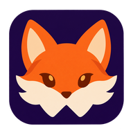

<p align="center"></p>

<h1 align="center">AgentWhisker</h1>

<p align="center">A fox-eared desktop companion for coding agents.</p>

<p align="center"><a href="../../releases/latest">Windows downloads</a> · <a href="https://strangepers.github.io/agentwhisker/">Project website</a></p>
<p align="center"><a href="https://strangepers.github.io/agentwhisker/?lang=en">English</a> · <a href="docs/quickstart.es.md">Español</a> · <a href="docs/quickstart.zh-CN.md">简体中文</a> · <a href="docs/quickstart.hi.md">हिन्दी</a></p>


Kitsu rests when your agent is idle, types while it works, waits when a decision is needed, and reacts to errors. She lives in a transparent window on your desktop. Click through the background to keep working in the windows beneath her.

Connect **Codex, Claude Code, OpenCode, or Qwen Code** directly from the gear menu. [Connect your agent](#connect-codex-claude-code-opencode-or-qwen-code).

## Meet Kitsu


## Get started

1. Download the portable **Windows x64** ZIP from [GitHub Releases](../../releases).
2. Extract the whole archive and open **AgentWhisker.exe**.
3. Start your coding agent, hover over Kitsu, and choose the agent under **Source** in the gear menu.

The tray menu shows, hides, or quits AgentWhisker. **Idle animation** runs continuously by default. Switch it to **Only on events** to keep Kitsu still between tasks. The free download includes Kitsu. Additional characters can be imported from a `.whiskerpack` file in settings.

<details>
<summary>See the language and animation settings</summary>


</details>

## Languages

AgentWhisker is available in English, Spanish, Simplified Chinese, and Hindi. It follows your system language by default and uses English when no supported system language is available. Choose **Language** in the companion settings to override it. Task titles and messages from connected sources stay in their original language.

## Connect Codex, Claude Code, OpenCode, or Qwen Code

Start your coding agent under the same Windows user account. Hover over Kitsu, open the gear menu, expand **Source**, and choose your agent. AgentWhisker reads the agent's local session state. The standalone connection works with the agent and AgentWhisker installed.

| Source | What AgentWhisker reads |
|---|---|
| Codex | Local session records from `CODEX_HOME` or `~/.codex` |
| Claude Code | Top-level project session records from `CLAUDE_CONFIG_DIR` or `~/.claude` |
| OpenCode | The local OpenCode service when it is running, or the local session database in read-only mode |
| Qwen Code | Compatible local project session records from `QWEN_RUNTIME_DIR`, `QWEN_HOME`, or `~/.qwen` |

OpenCode's running service exposes pending questions and permission requests. The transcript sources can show a question when the agent records its input request. Start a session in the agent to populate its source. T3Code remains experimental.

## Connect a JSON status file

AgentWhisker starts in standalone mode. Pick a JSON status file in settings or pass its path on launch.

```powershell
.\AgentWhisker.exe --status-file=C:\example\status.json
```

A status file can contain `{"state":"running","title":"Building the project"}`. The four values are `idle`, `running`, `waiting`, and `failed`.

## Build and test

Build on Windows x64 with Node.js 22.13 or newer.

```powershell
npm ci
npm test
npm start
npm run build:win
```

The Windows build is in `dist/AgentWhisker-win32-x64`. For an offline build, pass a pre-extracted Windows x64 Electron distribution matching the version in `package.json`.

```powershell
node scripts/build-win.cjs C:\Tools\electron-win32-x64
```

The desktop smoke tests use temporary profiles. Install Playwright separately and set `PLAYWRIGHT_MODULE` if Node cannot locate the module.

```powershell
$appExe = '.\dist\AgentWhisker-win32-x64\AgentWhisker.exe'
node test/desktop-smoke.cjs $appExe
node test/tasks-smoke.cjs $appExe
```

Windows 11 x64 is the tested platform. macOS and Linux are planned.

## Agent Console

Agent Console can launch the companion and supply live task and usage status via its local bridge. The [Windows connection script](integrations/Connect-AgentConsole.ps1) links the installed app resources to the selected Console release. The two launch modes share the character library and keep their own window and source settings. Use `node test/console-smoke.cjs $appExe` to check the bridge with a local Console installation.

## Licenses

Software is distributed under [MIT](LICENSE), with inherited and upstream credits in [NOTICE.md](NOTICE.md). Kitsu, other character artwork, and derived media have [separate artwork terms](ARTWORK.md).
