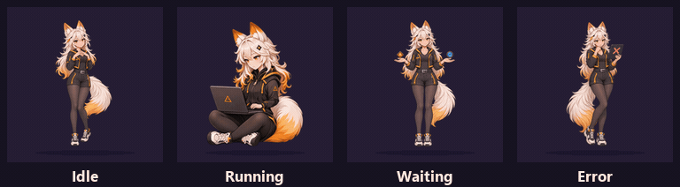

<p align="center"></p>

<h1 align="center">AgentWhisker</h1>

<p align="center">See what your coding agents are doing through Kitsu’s animations.</p>

<p align="center"><a href="#downloads-and-compatibility">Downloads</a> · <a href="https://strangepers.github.io/agentwhisker/">Project website</a></p>
<p align="center"><a href="https://strangepers.github.io/agentwhisker/?lang=en">English</a> · <a href="docs/quickstart.es.md">Español</a> · <a href="docs/quickstart.zh-CN.md">简体中文</a> · <a href="docs/quickstart.hi.md">हिन्दी</a></p>


Kitsu rests when your agent is idle, types while it works, waits when a decision is needed, and reacts to errors. She lives in a transparent window on your desktop. Click through the background to keep working in the windows beneath her.

Connect **Codex, Claude Code, OpenCode, or Qwen Code** directly from the gear menu. [Connect your agent](#connect-codex-claude-code-opencode-or-qwen-code).

On Windows, open **Source → Track agents** and check each agent you want Kitsu to follow. If you previously selected **Codex + OpenCode**, both stay selected. The bubble counts active tasks across your sources. Expand **Recently completed** to see finished work.

Codex tracking also recognizes a forked chat whose journal begins with its parent’s metadata. When RoleShuttle-Hybrid reports a task ID, Kitsu can group workers in that task’s worktree under one entry. A separate Codex chat still adds one to the count.

## Meet Kitsu



**New in v0.1.11 for Windows.** Kitsu eases into her next pose as the task count rolls up or down. Open the bubble to see new tasks slide into place. When a task finishes, its row fades and the panel shrinks around the remaining work. The transitions respect the system’s reduced-motion preference.

[Watch the pose and counter transitions](docs/media/pose-and-counter.mp4) · [Watch the task list grow and shrink](docs/media/task-list.mp4)

## Downloads and compatibility

| Platform | Channel | Download or build |
|---|---|---|
| Windows x64 | Stable | [Portable ZIP from GitHub Releases](../../releases/latest) |
| Linux x64 with X11 | Preview | [`tar.gz` from GitHub Releases](../../releases/tag/v0.1.3-preview.1) |
| macOS on Apple Silicon | Preview | [ZIP containing the `.app` from GitHub Releases](../../releases/tag/v0.1.3-preview.1) |

### Get started on Windows

1. Download the portable **Windows x64** ZIP from [GitHub Releases](../../releases).
2. Extract the whole archive and open **AgentWhisker.exe**.
3. On first launch, click your agent in Kitsu’s settings. Start a session to see her respond. You can also choose a source manually or keep Kitsu on your desktop. Open the gear menu to change the source later.

The tray menu shows, hides, or quits AgentWhisker. **Idle animation** runs continuously by default. Switch it to **Only on events** to keep Kitsu still between tasks. The free download includes Kitsu. Additional characters can be imported from a `.whiskerpack` file in settings.

<details>
<summary>See the language and animation settings</summary>


</details>

## Windows sign-in and notifications

Starting with [v0.1.6 for Windows](../../releases/tag/v0.1.6), open Kitsu’s settings to start AgentWhisker at sign-in or show quiet notifications when a task needs a reply or fails. Both switches start off. After moving the portable folder, enable sign-in again from its new location. If Agent Console starts the same copy, its companion takes over from the sign-in instance.

## Languages

AgentWhisker is available in English, Spanish, Simplified Chinese, and Hindi. It follows your system language by default and uses English when no supported system language is available. Choose **Language** in the companion settings to override it. Task titles and messages from connected sources stay in their original language.

## Connect Codex, Claude Code, OpenCode, or Qwen Code

Start your coding agent under the same user account as AgentWhisker. Hover over Kitsu, open the gear menu, expand **Source**, and check your agents. AgentWhisker reads the agent's local session state. The source descriptions below reflect the tested Windows release.

| Source | What AgentWhisker reads |
|---|---|
| Codex | Local session records from `CODEX_HOME` or `~/.codex` |
| RoleShuttle | Reads the companion status file in the RoleShuttle profile. Hybrid snapshots with task IDs support worktree grouping. |
| Claude Code | Top-level project session records from `CLAUDE_CONFIG_DIR` or `~/.claude` |
| OpenCode | The local OpenCode service when it is running, or the local session database in read-only mode |
| Qwen Code | Compatible local project session records from `QWEN_RUNTIME_DIR`, `QWEN_HOME`, or `~/.qwen` |

OpenCode's running service exposes pending questions and permission requests. The transcript sources can show a question when the agent records its input request. Start a session in the agent to populate its source. T3Code remains experimental.

When a Codex task lists **Open project folder** in Kitsu’s task bubble, click its row to open the session’s working directory. The action requires an available local folder. Agent Console tasks can open their chat. The other standalone sources show task status only.

## Subscription limits

Starting with [v0.1.3](../../releases/tag/v0.1.3), choose **Codex** or **OpenCode** under **Source**, then open the limits panel next to Kitsu.

- **Codex** reads limits through the installed Codex CLI when you are signed in with ChatGPT.
- **OpenCode Go** reads the allowance for the workspace connected to the running OpenCode service.

The panel shows the window with the least remaining usage for each provider. Expand the list to see the other windows. Saved values are marked when they become outdated. Set **Limits button** to **Hide** to keep the control off the desktop. Agent Console can supply its own limits and credits.

The gear opens settings beside Kitsu. Near the edge of a screen, the panel can open on the other side.

## Connect a JSON status file

AgentWhisker starts in standalone mode. Pick a JSON status file in settings or pass its path on launch.

```powershell
.\AgentWhisker.exe --status-file=C:\example\status.json
```

A status file can contain `{"state":"running","title":"Building the project"}`. Use `idle`, `running`, `waiting`, or `failed` to set Kitsu’s pose. `review` marks a finished task as Done while Kitsu returns to Idle. Unrecognized and expired statuses use the Idle pose and show an explanation in the task list. For a standalone status file, refresh active entries at least every five minutes while they are current. AgentWhisker uses `updatedAt` when provided and the file modification time otherwise.

With [RoleShuttle](https://github.com/StrangePers/RoleShuttle), your chat can delegate work to an implementer and a reviewer while Kitsu shows the current task state on your desktop. Run `roleshuttle companion --state running` and select the JSON path it prints in AgentWhisker’s settings. When the chat needs your answer, the controller can write `--state waiting` to the same file. [Connection guide](https://github.com/StrangePers/RoleShuttle/blob/v0.1.0a14/docs/integrations.md#agentwhisker).

## Build and test

Build on Windows x64 with Node.js 22.13 or newer.

```powershell
npm ci
npm test
npm start
npm run build:win
```

The Windows build is in `dist/AgentWhisker-win32-x64`. For an offline build, pass a pre-extracted Windows x64 Electron distribution matching the version in `package.json`.

```powershell
node scripts/build-win.cjs C:\Tools\electron-win32-x64
```

The desktop smoke tests use temporary profiles. Install Playwright separately and set `PLAYWRIGHT_MODULE` if Node cannot locate the module.

```powershell
$appExe = '.\dist\AgentWhisker-win32-x64\AgentWhisker.exe'
node test/desktop-smoke.cjs $appExe
node test/tasks-smoke.cjs $appExe
```

Build a preview from tag `v0.1.3-preview.1` on a native Linux x64 or Apple Silicon host with Node.js 22.13 or newer.

```sh
npm ci --ignore-scripts
npm test
npm run build:desktop
```

- **Linux x64**. Launch `dist/AgentWhisker-linux-x64/AgentWhisker` in an X11 session with a compositor. A tray icon requires desktop tray support. Native Wayland and Linux ARM are outside this preview.
- **macOS Apple Silicon**. Run `dist/AgentWhisker-darwin-arm64/AgentWhisker.app` on the Mac that built it. Preview archives are ad hoc signed. A public build with standard Gatekeeper approval requires Developer ID signing and notarization. Intel Macs are outside this preview.

The [desktop previews workflow](../../actions/workflows/desktop-previews.yml) builds and checks each archive on its target OS. The JSON status file provides a way to test all four states without a connected agent.

## Agent Console

Agent Console can launch the companion and supply live task and usage status via its local bridge. The [Windows connection script](integrations/Connect-AgentConsole.ps1) links the installed app resources to the selected Console release. The two launch modes share the character library and keep their own window and source settings. Use `node test/console-smoke.cjs $appExe` to check the bridge with a local Console installation.

## Licenses

Software is distributed under [MIT](LICENSE), with inherited and upstream credits in [NOTICE.md](NOTICE.md). Kitsu, other character artwork, and derived media have [separate artwork terms](ARTWORK.md).
